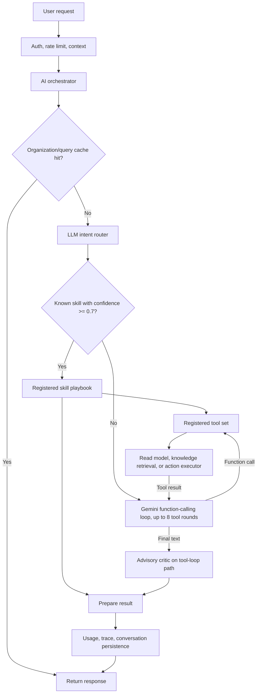
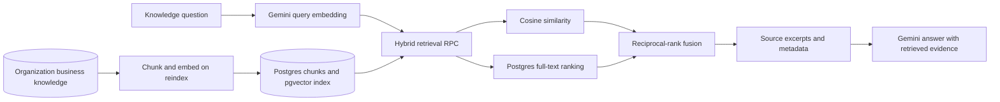

# CapitaEdgeX

**A GST-compliant invoicing and finance workspace for Indian businesses, with an agentic AI layer over live financial data.**

🔗 **Live product: [capitaedgex.com](https://capitaedgex.com/)**

**Application repositories:** [Frontend](https://github.com/amathziah/capita-edge-x-frontend) · [Backend](https://github.com/amathziah/capita-edge-x-backend)

> **About this repository.** CapitaEdgeX is a commercial product and the application source is
> maintained in the public frontend and backend repositories linked above. This repo is the public
> technical record: the architecture, the design decisions worth defending, and the parts of the
> codebase that carry no commercial sensitivity (the GST/SAC tax engine, which is built on public
> tax data and included here in full).


---

## What it does

Create GST-compliant invoices, track payments, manage expenses, and get tax-deadline reminders.
On top of that sits an AI layer that does not merely answer questions about the data — it runs
multi-step workflows against it: **collections sweep**, **month-end close**, **cash-shortfall
response**.

## Architecture

Full write-up: **[docs/ai-architecture.md](docs/ai-architecture.md)**

The backend uses a bounded agentic workflow. An LLM intent router can select a registered multi-step skill; other requests enter Gemini's function-calling loop, where the model can call only tools declared by the backend.



| Layer | Responsibility |
| :--- | :--- |
| **Intent router** | Classifies the request; high-confidence registered skill matches use a playbook |
| **Orchestrator** | Runs skill steps or a Gemini function-calling loop capped at 8 tool rounds |
| **Tool registry** | Declares and dispatches the tools available to Gemini |
| **Read model** | Returns organization-scoped, query-shaped business data |
| **Knowledge retrieval** | Combines pgvector similarity with PostgreSQL full-text search |
| **Action executor** | Runs registered UI actions and selected server-side mutations |
| **Critic** | Advisory second-model check on the regular tool-loop answer |
| **Trace** | Stores plan, route, tool, and error events; action execution can append final-stage records |

### Hybrid RAG for business knowledge



The `get_knowledge_base` tool exposes hybrid retrieval for organization knowledge. Chunks are embedded with Gemini `gemini-embedding-001` and ranked using pgvector cosine similarity plus Postgres full-text search. If vector search is unavailable or has no matches, the backend falls back to organization-scoped keyword matching. Existing entries require the backend migration and a reindex operation before they are in the vector index.

---

## Design choices and current limits

### 1. Tax rules are deterministic; the assistant is grounded in retrieved data

The public tax engine contains deterministic GSTIN validation, state mapping, and intra- versus inter-state tax classification. The AI backend retrieves live business facts through organization-scoped tools and instructs Gemini to ground user-data claims in tool evidence. The model still writes the natural-language answer; the critic is advisory, not a guarantee.

The tax engine is included in this repo: [`src/tax/`](src/tax/).

### 2. A critic flags unsupported claims on one path

A second, cheaper model pass checks the regular function-calling answer against successful tool
results for unsupported numbers, names, dates, and claims about user data.

The critic does not run for skill workflows, and it does not block or revise the original answer.
It **fails open** if unavailable or malformed. Treat it as an additional signal, not a safety
boundary or a guarantee of hallucination-free output.

### 3. Bounded workflows with explicit operational limits

- **Defined tool surface and fixed skills** — the model can only invoke declared functions; skills encode repeatable multi-step playbooks.
- **Model fallback chain and process-local rate bucket** — retry and cooldown behavior are implemented in the backend runtime.
- **Short-term chat caching and traces** — chat responses are cached by organization/query and orchestration stages are persisted.
- **Approval is not universal** — Collections Sweep pauses before its drafts are sent, but mutation-capable tools in the regular tool loop can execute directly.
- **Plan budgets are not currently enforced** — the budget service reports unlimited usage, although usage is logged.
- **Model complexity routing is not currently active** — the router's model selection currently returns `gemini-2.5-flash` regardless of detected complexity.

For endpoint setup, module paths, and the full operational flow, see [the AI architecture guide](docs/ai-architecture.md) and the linked [backend source repository](https://github.com/amathziah/capita-edge-x-backend).

---

## The tax engine (included source)

Real, runnable code with no commercial sensitivity — it encodes public Indian tax data.

**[`src/tax/gstUtils.js`](src/tax/gstUtils.js)**
GSTIN format validation, state-code mapping for all states and UTs, and intra- vs inter-state
detection that decides CGST+SGST versus IGST.

**[`src/tax/sacDatabase.js`](src/tax/sacDatabase.js)**
SAC (Service Accounting Code) catalogue mapped to GST rates and TDS sections, with
auto-suggestion from an item description — so a user writing "logo design" gets the right code,
rate and TDS section without knowing any of them.

```js
import { validateGstin, getGstType } from './src/tax/gstUtils.js';

validateGstin('29ABCDE1234F1Z5');        // → true
getGstType('29ABCDE…', '29ABCDE…');      // → intra-state: CGST + SGST
getGstType('29ABCDE…', '27ABCDE…');      // → inter-state: IGST
```

---

## Stack

**Backend** Node.js · Express · PostgreSQL (Supabase) · Redis · `decimal.js` · PDFKit · Nodemailer
**Frontend** React · Vite · Tailwind
**AI** Google Gemini — orchestrator, tool registry, critic, model router
**Infra** Docker · Vercel (web) · Render (API) · CI secret scanning

## Author

**Amathziah J** — [LinkedIn](https://www.linkedin.com/in/amathziah-j-832646214/) · [GitHub](https://github.com/amathziah)
