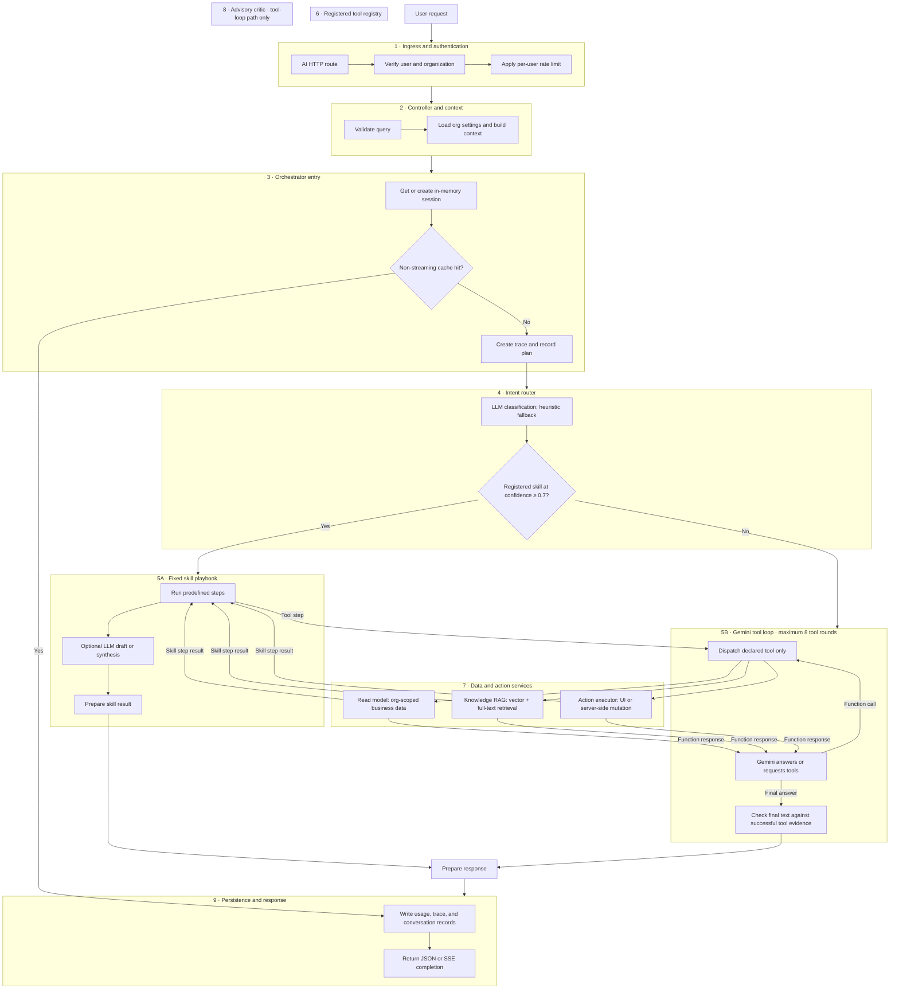
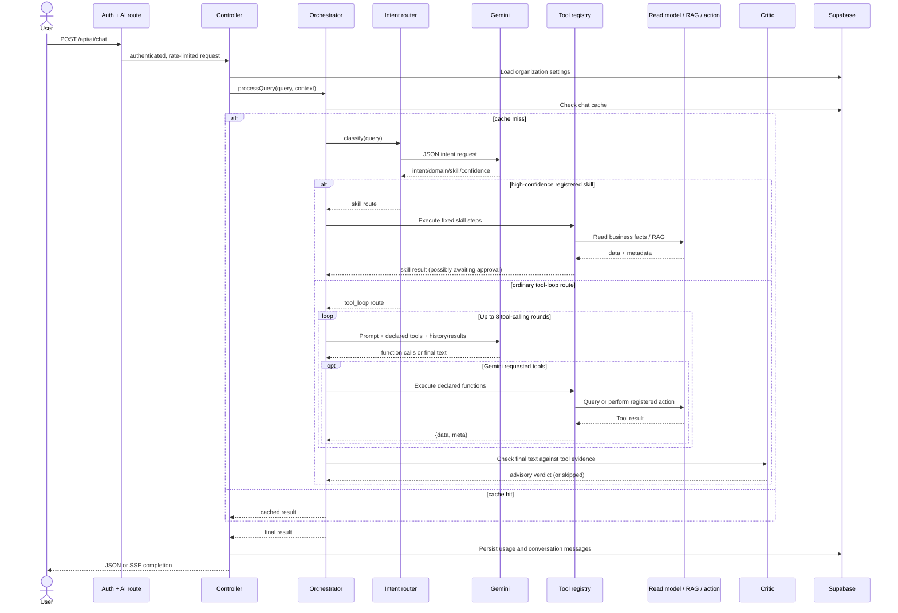
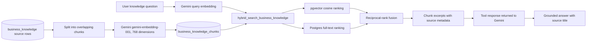

# CapitaEdgeX AI Architecture

This is the architecture of the AI backend in [`capita-edge-x-backend`](https://github.com/amathziah/capita-edge-x-backend). The application source is maintained in that repository; this repository is the public technical record and contains the GST/SAC tax engine.

## Overview

The assistant is a bounded agentic system. It has an LLM intent router, a catalog of registered tools, three deterministic skill playbooks, a query-shaped read model, a knowledge retrieval service, and a Gemini function-calling loop. Model-generated text is grounded by instructions and tool results. A critic provides an advisory check on the regular tool-loop path.

The regular function-calling loop runs for at most eight model/tool rounds. Skills use their own predefined steps. The intent router falls back to heuristics if the model is unavailable. A skill is selected only when the intent is `skill_invocation`, its ID is registered, and its confidence is at least `0.7`.

## Layer-by-layer execution

Each layer has a narrow job and passes a shaped result to the next layer. The table follows a cache-miss chat request from HTTP ingress through response persistence.

| # | Layer | Input | Work performed | Output / handoff | Failure behavior / limit |
| --- | --- | --- | --- | --- | --- |
| 1 | **Ingress and auth** | HTTP request, bearer token, optional organization header | Global auth verifies the user, resolves the active organization through `organization_users`, then the AI route applies a per-user/IP rate limit. | Authenticated request with `req.user.organizationId` enters the controller. | Missing/invalid auth or invalid organization membership is rejected before AI code runs; rate limit returns an error response. |
| 2 | **Controller and context** | `query`, persona, caller history, agent/conversation IDs | `chat.controller.js` validates the query. `getAIContext()` loads organization settings and constructs currency, business type, temporal context, history, and IDs. | Query plus tenant-scoped AI context passed to `processQuery()`. | Missing query returns HTTP 400. Settings lookup is caught and context falls back to defaults. |
| 3 | **Session and cache** | Query, organization ID, user/conversation IDs | Orchestrator creates a trace ID, gets/creates an in-process session, then checks chat cache in the non-streaming path. Cache keys use organization and normalized query. On a cache miss, it records a `plan` trace. | Cache hit returns the cached result; cache miss proceeds to intent classification. | Cache identity omits persona and history; cache hit returns before a plan/route trace is written. Streaming chat bypasses this cache lookup. Sessions are not saved to `ai_sessions` by the main chat path. |
| 4 | **Intent routing** | Query, recent request context, registered skill trigger descriptions | Intent router calls Gemini JSON classification (flash-lite first) or uses heuristic fallback. It validates returned intent, domain, registered skill ID, and confidence. | `{ intent, domain, suggestedSkill, confidence }` selects a skill only at confidence `>= 0.7`; otherwise it selects the function-calling loop. | Model/network or JSON parse failure falls back to keyword heuristics; fallback cannot select a skill. |
| 5A | **Skill playbook** | Skill ID, query, organization context | Registry dispatches one of three fixed workflows. Skills run predetermined tool steps and may call the LLM for drafting/synthesis. Collections Sweep stops with drafts awaiting approval. | Skill status, steps, drafts/narrative/recommendation, and tool provenance. The skill path does not invoke the critic. | Tool failures may short-circuit or produce partial results; narrative/draft generation can use deterministic fallback text. Approval does not resume a persisted skill run. |
| 5B | **Gemini tool loop** | Query, caller history, system prompt, declared functions | Gemini decides whether to answer or request a registered tool. Each tool batch is executed, returned as a function response, and the model is called again. Fallback model chain is tried on retryable provider failures. | Final text, usage, tool calls/results, chosen provider, and loop metadata. Maximum: eight tool-calling rounds, then a final generation attempt if needed. | Tool errors are returned to the model as function responses. Retryable model failures advance through the configured model chain; other failures terminate the request. |
| 6 | **Tool registry** | Gemini function call `{name, args}` or a skill's fixed step | Registry dispatches the declared tool name to the read model, knowledge service, analytics helpers, or action executor. | Tool result in `{ data, meta }` form (or an error), logged to the trace and returned to Gemini/skill. | Unknown tool names throw and are converted to tool errors by the orchestrator. |
| 7A | **Business read model** | Tool name and organization ID | Queries Supabase/analytics for invoices, payments, expenses, compliance tasks, customer intelligence, and dashboard summaries. Domain queries explicitly filter by `organization_id`. | Compact domain payload plus provenance metadata such as source, currency, row count, and generated time. | Database errors generally propagate; some analytics lookups are caught and represented with empty/default values. |
| 7B | **Knowledge retrieval (RAG)** | Knowledge query and organization ID | Embeds the query, calls the hybrid search RPC, combines vector and full-text rankings, and falls back to keyword matching when needed. | Top source chunks with title/category/content and source identifiers returned as tool evidence. | Missing/unavailable hybrid search falls back to lexical search. Records need reindexing for vector results. |
| 7C | **Action execution** | Registered action/tool and payload | Runs UI navigation/modal responses or server-side operations such as customer creation, invoice draft creation, or reminder sending. | Action result; some operations have real database/email side effects. The regular function loop has no universal approval gate. | Validation and business-rule checks vary by action; Collections Sweep's review gate applies only to that skill's draft workflow. |
| 8 | **Critic** | Final text, original query, successful tool evidence | On the regular function-calling path, a second Gemini call checks for unsupported numbers, names, dates, and user-data claims. | Advisory verdict metadata. It does not block or revise the answer; errors fail open. | Skipped with no successful tools, unavailable model, or critic parse/call error. Never treats `ok` as a hard gate. |
| 9 | **Persistence and response** | Skill/tool result, usage metadata, trace ID | Controller writes usage to `ai_requests`, conversation messages to `ai_conversations`/`ai_chat_messages`, while orchestrator/tool calls write trace records. Response contains text, provider, data, budget, action, and trace metadata as available. | JSON response or SSE `complete` event. Current SSE path does not emit incremental model tokens. | History failures are logged and do not fail the chat response; a response may return even when optional persistence fails. |

### Chat sequence

## Request and module boundaries

Routes are mounted under `/api`; global authentication resolves the user and active organization before AI routes execute. The main conversation endpoints are `POST /api/ai/chat` and `POST /api/ai/chat/stream`.

| Module | Role |
| --- | --- |
| `src/modules/ai/ai.route.js` | Route definitions and AI/meta rate limits. |
| `src/modules/ai/controllers/chat.controller.js` | Chat/SSE request handling, context construction, usage logging, and conversation persistence. |
| `src/modules/ai/controllers/ops.controller.js` | Structured AI operations, collection endpoints, action execution, traces, and knowledge reindex endpoint. |
| `src/modules/ai/controllers/history.controller.js` | Conversation and message history APIs. |
| `src/modules/ai/core/orchestrator.service.js` | Intent routing, skill dispatch, function-calling loop, tool execution, response assembly, and critic invocation. |
| `src/modules/ai/intent/router.service.js` | LLM classification with heuristic fallback. |
| `src/modules/ai/workspace/toolRegistry.service.js` | Gemini tool declarations and tool dispatch. |
| `src/modules/ai/workspace/readModel.service.js` | Tenant-scoped reads and finance data shaping. |
| `src/modules/ai/workspace/guidedDesk.service.js` | Workspace payloads and labels for frontend views. |
| `src/modules/ai/skills/` | Collections Sweep, Month-End Close, Cash Shortfall Response. |
| `src/modules/ai/search/semantic.service.js` | Knowledge chunking/indexing, embeddings, hybrid retrieval, keyword fallback. |
| `src/modules/ai/core/runtime.service.js` | Gemini client, local rate bucket/cooldown, retry classification, request locks. |
| `src/modules/ai/core/structuredTask.service.js` | JSON tasks and input-grounded validators. |
| `src/modules/ai/core/critic.service.js` | Advisory answer/evidence comparison. |
| `src/modules/ai/infra/` | Budget interface, cache, model router, and trace persistence. |
| `src/modules/ai/actions/executor.service.js` | Registered UI actions and server-side mutations. |
| `src/modules/ai/agent/session.service.js` | In-process session state and optional database session load/save methods. |

## Separate path for structured AI tasks

Invoice parsing, invoice audits, collection drafts, settlement drafts, and command parsing do not use the main intent-router/tool-loop path. Their controllers call the stable AI service facade, which delegates JSON generation and validation to `structuredTask.service.js`.

```mermaid
flowchart LR
    REQUEST[Structured task endpoint] --> CONTROLLER[Chat or ops controller]
    CONTROLLER --> GATE[Credit/budget check]
    GATE --> FACADE[AI service facade]
    FACADE --> TASK[Structured task service]
    TASK --> CACHE[Task response cache / in-flight lock]
    CACHE --> RUNTIME[Gemini runtime and model fallback chain]
    RUNTIME --> MODEL[JSON-mode Gemini generation]
    MODEL --> VALIDATE[Task-specific source validator]
    VALIDATE -->|Valid| RESULT[Sanitized structured result]
    VALIDATE -->|Unsupported or invalid| ERROR[Reject result and return validation error]
    RESULT --> AUDIT[Usage persistence]
```

Invoice text extraction validates numeric claims against the provided OCR text. Invoice audits and collection/settlement drafts validate their numeric claims against the supplied invoice. Command parsing only allows `create_customer` or `unknown`. The validator may reject unsupported numbers or malformed shapes; there is no general critic pass on these endpoints. Insights and revenue prediction are separate local/rule-based paths.

The budget check is present in several controllers, but `AIBudgetService` currently returns unlimited starter usage, so that check does not enforce plan limits today.

## Skills

Skills are fixed playbooks: they define their own steps and call the shared tool/LLM runners.

| Skill | Steps |
| --- | --- |
| `collections_sweep` | Fetch overdue invoices; fetch payment patterns; draft up to ten messages; return an approval gate. |
| `month_end_close` | Fetch dashboard, payments, expenses, invoices, and deadlines concurrently; summarize the results. |
| `cash_shortfall_response` | Predict 30-day cash position; inspect overdue receivables and spend categories; produce a recommended action sequence. |

Collections Sweep returns `awaiting_approval`, but its plan is not persisted/resumed as an agent run. Sending is handled separately via the collection send endpoint or an explicit action. The critic does not run on skill results.

## Tool retrieval and RAG

Live finance data is queried through the tool registry and the AI read model. Each database read must be scoped by `organization_id`; the backend frequently uses the Supabase service role, which bypasses ordinary row-level filtering.

Business knowledge uses the `get_knowledge_base` function tool. Gemini decides whether to call it; retrieval is not automatic for every query.

The hybrid search filters results by organization, ranks chunks by vector similarity and full-text relevance, then combines rankings with reciprocal-rank fusion. If the hybrid RPC or query embedding fails, or indexed search has no results, the service falls back to keyword matching over the source table. This fallback is still lexical retrieval, not vector RAG.

### Database activation

Apply `database/migrations/20261119_hybrid_business_knowledge_search.sql` in the backend repository. It enables pgvector, creates the source and chunk tables if needed, installs the search-vector trigger and indexes, adds organization membership policies using `organization_users`, and creates the hybrid-search RPC. The backend requires `GEMINI_API_KEY` to generate embeddings.

After applying the migration, reindex existing records through authenticated `POST /api/ai/knowledge/reindex`. The request may include `{ "entryId": "<uuid>" }` to index one record. New knowledge writes should call `aiSemanticSearchService.indexEntry(entry, organizationId)` after saving the source row. Until indexing is complete, source rows are not present in the vector index; the keyword fallback remains available.

## Grounding and side effects

- Chat system instructions tell the model to rely on tool results for business numbers, names, dates, and statuses.
- Structured tasks use JSON-mode generation and task-specific validators against their source input.
- The critic checks only concrete unsupported claims against successful tool results. It returns verdict metadata; it does not revise or reject a response, and it fails open on model errors.
- Skills return their generated or deterministic fallback result without a critic check.
- Registered tools include reads and mutation-capable functions. Customer creation, invoice draft creation, and reminder sending can occur from the regular function-calling path. Not every mutation has a server-side approval gate.
- Collections Sweep’s approval status stops that skill before sending; it is not a generic transaction approval framework.

## Persistence and runtime controls

The AI module writes request usage to `ai_requests`, traces to `ai_tool_traces`, and conversations/messages to `ai_conversations` and `ai_chat_messages`. The session service also has `ai_sessions` methods, but the main chat flow keeps state in process memory and does not call its database save method.

The Gemini runtime has a process-local token bucket, transient-error retry classification, a cooldown state, and request locking for structured tasks. Chat responses use short-term memory and Supabase cache entries keyed by organization and normalized query. The cache key does not include conversation history or persona.

## Limits that matter

- `AIBudgetService` currently returns an unlimited starter budget. Plan budget checks are not enforcing tier limits, although usage is logged and budget/status endpoints exist.
- Model complexity is detected, but `AIModelRouterService.selectModel()` currently always selects `gemini-2.5-flash`.
- Runtime rate and cooldown state are local to each server process.
- `/api/ai/chat/stream` emits SSE heartbeat and completion events, but does not currently stream generated tokens incrementally.
- The critic is an advisory check on the ordinary tool loop, not a hallucination-free guarantee.
- Explicit `organization_id` filters remain essential while service-role database access is used.

## Related code

- [Backend repository](https://github.com/amathziah/capita-edge-x-backend)
- [Public GST/SAC tax engine](../src/tax/)
- [Backend AI module guide](https://github.com/amathziah/capita-edge-x-backend/blob/main/docs/ai-architecture.md)
