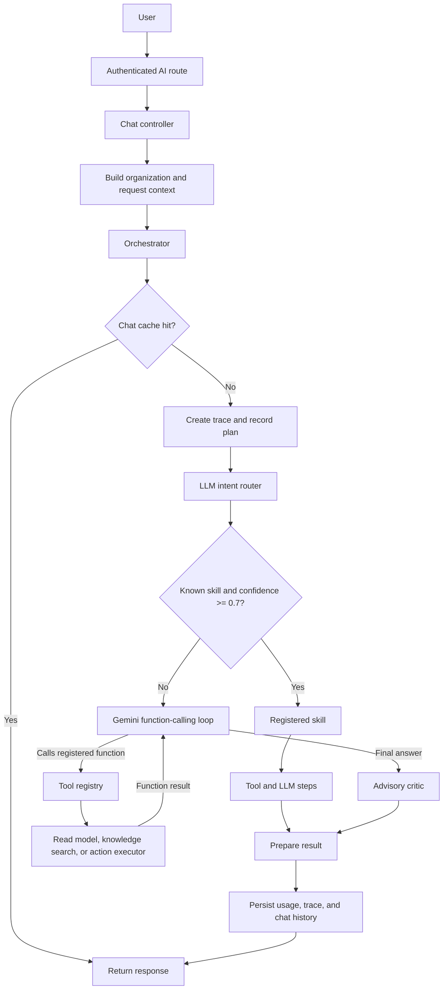
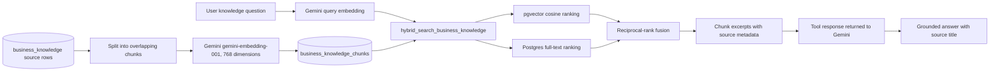

# CapitaEdgeX AI Architecture

This is the architecture of the AI backend in [`capita-edge-x-backend`](https://github.com/amathziah/capita-edge-x-backend). The application source is maintained in that repository; this repository is the public technical record and contains the GST/SAC tax engine.

## Overview

The assistant is a bounded agentic system. It has an LLM intent router, a catalog of registered tools, three deterministic skill playbooks, a query-shaped read model, a knowledge retrieval service, and a Gemini function-calling loop. Model-generated text is grounded by instructions and tool results. A critic provides an advisory check on the regular tool-loop path.

The regular function-calling loop runs for at most eight model/tool rounds. Skills use their own predefined steps. The intent router falls back to heuristics if the model is unavailable. A skill is selected only when the intent is `skill_invocation`, its ID is registered, and its confidence is at least `0.7`.

## Request and module boundaries

Routes are mounted under `/api`; global authentication resolves the user and active organization before AI routes execute. The main conversation endpoints are `POST /api/ai/chat` and `POST /api/ai/chat/stream`.

| Module | Role |
| --- | --- |
| `src/modules/ai/ai.route.js` | Route definitions and AI/meta rate limits. |
| `src/modules/ai/controllers/chat.controller.js` | Chat/SSE request handling, context construction, usage logging, and conversation persistence. |
| `src/modules/ai/controllers/ops.controller.js` | Structured AI operations, collection endpoints, action execution, traces, and knowledge reindex endpoint. |
| `src/modules/ai/controllers/history.controller.js` | Conversation and message history APIs. |
| `src/modules/ai/core/orchestrator.service.js` | Intent routing, skill dispatch, function-calling loop, tool execution, response assembly, and critic invocation. |
| `src/modules/ai/intent/router.service.js` | LLM classification with heuristic fallback. |
| `src/modules/ai/workspace/toolRegistry.service.js` | Gemini tool declarations and tool dispatch. |
| `src/modules/ai/workspace/readModel.service.js` | Tenant-scoped reads and finance data shaping. |
| `src/modules/ai/workspace/guidedDesk.service.js` | Workspace payloads and labels for frontend views. |
| `src/modules/ai/skills/` | Collections Sweep, Month-End Close, Cash Shortfall Response. |
| `src/modules/ai/search/semantic.service.js` | Knowledge chunking/indexing, embeddings, hybrid retrieval, keyword fallback. |
| `src/modules/ai/core/runtime.service.js` | Gemini client, local rate bucket/cooldown, retry classification, request locks. |
| `src/modules/ai/core/structuredTask.service.js` | JSON tasks and input-grounded validators. |
| `src/modules/ai/core/critic.service.js` | Advisory answer/evidence comparison. |
| `src/modules/ai/infra/` | Budget interface, cache, model router, and trace persistence. |
| `src/modules/ai/actions/executor.service.js` | Registered UI actions and server-side mutations. |
| `src/modules/ai/agent/session.service.js` | In-process session state and optional database session load/save methods. |

## Skills

Skills are fixed playbooks: they define their own steps and call the shared tool/LLM runners.

| Skill | Steps |
| --- | --- |
| `collections_sweep` | Fetch overdue invoices; fetch payment patterns; draft up to ten messages; return an approval gate. |
| `month_end_close` | Fetch dashboard, payments, expenses, invoices, and deadlines concurrently; summarize the results. |
| `cash_shortfall_response` | Predict 30-day cash position; inspect overdue receivables and spend categories; produce a recommended action sequence. |

Collections Sweep returns `awaiting_approval`, but its plan is not persisted/resumed as an agent run. Sending is handled separately via the collection send endpoint or an explicit action. The critic does not run on skill results.

## Tool retrieval and RAG

Live finance data is queried through the tool registry and the AI read model. Each database read must be scoped by `organization_id`; the backend frequently uses the Supabase service role, which bypasses ordinary row-level filtering.

Business knowledge uses the `get_knowledge_base` function tool. Gemini decides whether to call it; retrieval is not automatic for every query.

The hybrid search filters results by organization, ranks chunks by vector similarity and full-text relevance, then combines rankings with reciprocal-rank fusion. If the hybrid RPC or query embedding fails, or indexed search has no results, the service falls back to keyword matching over the source table. This fallback is still lexical retrieval, not vector RAG.

### Database activation

Apply `database/migrations/20261119_hybrid_business_knowledge_search.sql` in the backend repository. It enables pgvector, creates the source and chunk tables if needed, installs the search-vector trigger and indexes, adds organization membership policies using `organization_users`, and creates the hybrid-search RPC. The backend requires `GEMINI_API_KEY` to generate embeddings.

After applying the migration, reindex existing records through authenticated `POST /api/ai/knowledge/reindex`. The request may include `{ "entryId": "<uuid>" }` to index one record. New knowledge writes should call `aiSemanticSearchService.indexEntry(entry, organizationId)` after saving the source row. Until indexing is complete, source rows are not present in the vector index; the keyword fallback remains available.

## Grounding and side effects

- Chat system instructions tell the model to rely on tool results for business numbers, names, dates, and statuses.
- Structured tasks use JSON-mode generation and task-specific validators against their source input.
- The critic checks only concrete unsupported claims against successful tool results. It returns verdict metadata; it does not revise or reject a response, and it fails open on model errors.
- Skills return their generated or deterministic fallback result without a critic check.
- Registered tools include reads and mutation-capable functions. Customer creation, invoice draft creation, and reminder sending can occur from the regular function-calling path. Not every mutation has a server-side approval gate.
- Collections Sweep’s approval status stops that skill before sending; it is not a generic transaction approval framework.

## Persistence and runtime controls

The AI module writes request usage to `ai_requests`, traces to `ai_tool_traces`, and conversations/messages to `ai_conversations` and `ai_chat_messages`. The session service also has `ai_sessions` methods, but the main chat flow keeps state in process memory and does not call its database save method.

The Gemini runtime has a process-local token bucket, transient-error retry classification, a cooldown state, and request locking for structured tasks. Chat responses use short-term memory and Supabase cache entries keyed by organization and normalized query. The cache key does not include conversation history or persona.

## Limits that matter

- `AIBudgetService` currently returns an unlimited starter budget. Plan budget checks are not enforcing tier limits, although usage is logged and budget/status endpoints exist.
- Model complexity is detected, but `AIModelRouterService.selectModel()` currently always selects `gemini-2.5-flash`.
- Runtime rate and cooldown state are local to each server process.
- `/api/ai/chat/stream` emits SSE heartbeat and completion events, but does not currently stream generated tokens incrementally.
- The critic is an advisory check on the ordinary tool loop, not a hallucination-free guarantee.
- Explicit `organization_id` filters remain essential while service-role database access is used.

## Related code

- [Backend repository](https://github.com/amathziah/capita-edge-x-backend)
- [Public GST/SAC tax engine](../src/tax/)
- [Backend AI module guide](https://github.com/amathziah/capita-edge-x-backend/blob/main/docs/ai-architecture.md)
